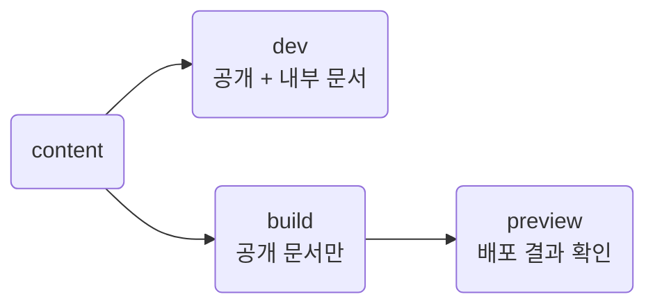

프로젝트 설정과 content 폴더에서 정적 사이트까지. 설치, 개발 서버, 빌드, 미리보기.
문서 형식은 [Writing](writing.md), 사이트 설정은 [Settings](settings.md), 배포는 [Deployment](deployment.md).

**Unreleased:** 이 페이지의 content 구조는 다음 릴리스용입니다. 현재 npm `0.13.1`은 기존 평면 문서 폴더와 `dev docs` 같은 실행 방식을 사용합니다. 기존 프로젝트 전환은 [Migration](migration.md).

## Overview



| Command | Result |
| --- | --- |
| `dev [project-dir]` | 공개·내부 문서를 함께 표시 · 원본 변경 시 새로고침 |
| `build [project-dir]` | `<content.root>/dist`에 공개 HTML과 참조 자원 출력 |
| `preview [project-dir]` | 이미 만든 공개 결과 미리보기 |

위치 인자는 설정 파일이 있는 **프로젝트 루트**입니다. 생략하면 현재 폴더를 사용합니다.
명령 생략은 `dev`. content 폴더 이름은 프로젝트 설정의 `content.root`에서 지정합니다.

::part[Setup]

## Local development

저장소 개발은 Node.js 22.12.0 이상과 pnpm.

```sh
git clone https://github.com/minu-ha/for-humanity.git
cd for-humanity
pnpm install
pnpm dev
```

접속: `http://localhost:4321/`. 저장소의 `content/public`과 `content/private`를 함께 표시합니다.

```sh
pnpm build
pnpm preview
```

### Use in another project

현재 공개 패키지 설치:

```sh
pnpm add -D --save-exact for-humanity@0.13.1
```

위 버전은 기존 문서 폴더 안에 설정·README·일반 문서를 두고 `pnpm exec for-humanity dev docs`로 실행합니다.
새 구조를 먼저 사용하려면 아래 방법으로 이 저장소에서 만든 패키지를 설치합니다.

### Test a local package

```sh
# for humanity 저장소
pnpm pack

# 문서 프로젝트
pnpm add -D /path/to/for-humanity-0.13.1.tgz
```

설치된 `node_modules/for-humanity/template`의 `for-humanity.config.ts`와 `content`를 프로젝트에 복사합니다. 기존 파일이 있다면 필요한 항목만 병합합니다.
기본형에는 홈, 시작 문서, `.gitkeep`으로 유지하는 private·asset 폴더가 포함되어 있습니다. 폴더별 역할은 시작 문서에서 설명합니다.
루트 `.gitignore`에 `content/dist/`를 추가합니다. 아직 `init` 명령은 제공하지 않습니다.

```text
project/
├── for-humanity.config.ts
└── content/
    ├── README.md
    ├── public/
    │   └── getting-started.md
    ├── private/
    └── asset/
```

프로젝트 루트에서 `pnpm exec for-humanity dev`를 실행합니다.
`content/dist`는 첫 빌드에서 생성되므로 기본형에는 포함하지 않습니다.

### Help and version

도움말과 버전 조회는 설정을 실행하거나 서버를 시작하지 않습니다.

```sh
pnpm exec for-humanity --help
pnpm exec for-humanity build --help
pnpm exec for-humanity --version
```

`-h`, `-v`도 사용 가능. 지원하지 않는 옵션과 프로젝트 경로를 여러 개 지정한 입력은 종료 코드 `1`로 실패합니다.

::part[Commands]

## dev

```sh
pnpm exec for-humanity dev
```

- 포트: 설정 `port` · 기본 `4321` · localhost 접속
- public과 private 문서를 함께 처리 · private 문서는 `/private/` 아래 표시
- Markdown·홈·로컬 그림·스니펫 추가·수정·삭제 → 다시 처리 → 열린 페이지 새로고침
- 잘못된 문서 → 터미널 오류 · 직전 정상 문서 유지
- 설정 변경 → 서버 재시작
- 저장소 `pnpm dev`: TS·TSX 변경은 페이지 갱신, CSS는 HMR 반영
- 설치 패키지 변경 → 다시 설치한 뒤 서버 재시작

## build

```sh
pnpm exec for-humanity build
```

기본 출력은 `content/dist`. 이전 결과를 지우고 공개 HTML·CSS·스크립트·글꼴·favicon과 참조된 자원을 생성합니다.
private 문서는 렌더링·목록·사이트맵·자원 수집에서 제외됩니다. 홈과 공개 문서가 private 파일을 참조하면 오류로 중단합니다.
배포 대상은 이 출력 폴더 전체이며, URL 기준은 사이트 루트 `/`입니다.

### Errors and warnings

| Kind | Trigger | Result |
| --- | --- | --- |
| Error | 설정·frontmatter 오류, 문서 ID 충돌, 공개 폴더 누락, 내부 자료 참조, 잘못된 블록 문법 | 종료 코드 `1` |
| Warning | 없는 공개 Markdown 링크, 설정에 없는 날짜 상태 문구 | 터미널 경고 · 빌드 계속 |

오류는 원본 파일과 줄 위치를 포함합니다. 성공은 표준 출력, 경고·오류는 표준 오류에 표시합니다.
Mermaid 문법 오류는 브라우저에서 표시하며 원본 코드를 남깁니다.

## preview

```sh
pnpm exec for-humanity preview
```

Vite preview가 `<content.root>/dist`의 빌드 결과를 제공합니다. 원본을 수정했다면 다시 `build`합니다.

- 접속: localhost · 설정 `port` 사용 · 기본 `4321`
- 빌드 결과가 없으면 `build` 안내와 종료 코드 `1`
- 설정 포트가 사용 중이면 다른 포트로 이동하지 않고 실패
- 없는 문서와 private 문서는 `404`
- 원본 감시·HMR·Hono API 실행 없음
- 별도 Vite 설정 불필요 · 프로젝트의 Vite 설정·환경 파일 자동 로드 제외

로컬 빌드 확인용입니다. 운영 배포는 [Deployment](deployment.md)를 따릅니다.

### Another project directory

다른 작업 폴더에서 실행할 때만 프로젝트 경로를 지정합니다.

```sh
pnpm exec for-humanity dev ../my-project
pnpm exec for-humanity build ../my-project
pnpm exec for-humanity preview ../my-project
```

세 명령 모두 `../my-project/for-humanity.config.ts`를 읽고 그 프로젝트의 content 경로를 사용합니다.
