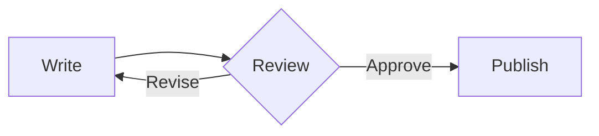
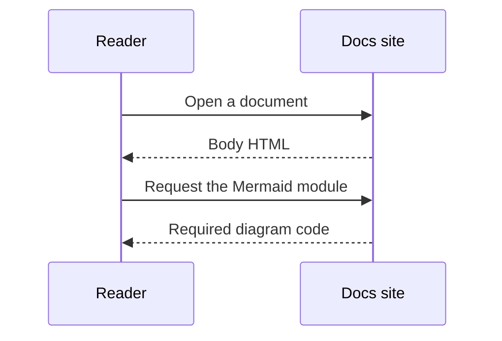
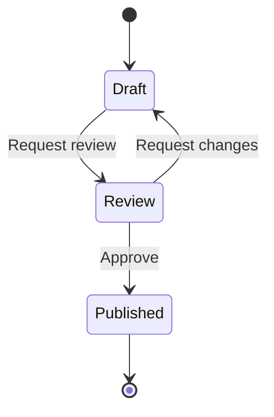
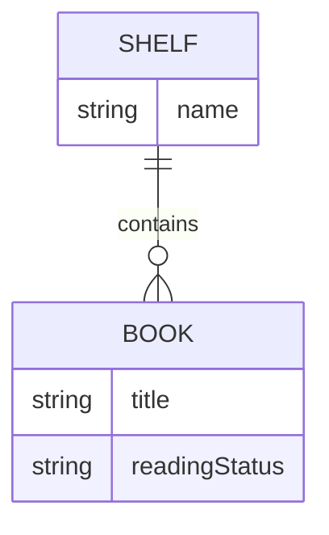
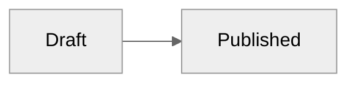

Choose the diagram that matches the meaning of the connections. Write every example in a `mermaid` code fence, and it is rendered with the official Mermaid 12.
You can write diagrams inside Markdown without installing anything extra. Diagrams are displayed in browsers with JavaScript enabled.

## Choose a diagram

| What to describe | Mermaid syntax | How to choose |
| --- | --- | --- |
| Procedures and conditional branches | `flowchart` | The next step and the forks |
| Requests and responses between participants | `sequenceDiagram` | Who sends which request to whom, and in what order |
| State transitions | `stateDiagram-v2` | The possible states and the events that change them |
| Data relationships | `erDiagram` | Entities and relationship cardinality |
| Folder and file hierarchy | `treeView-beta` | Parents and children, and items at the same level |

A flowchart does not have to express every relationship. For a short procedure, a list can be simpler, and for comparing items, a table can be simpler.
Other types included with Mermaid by default can be used in the same fence. External diagrams and icon packs that require separate registration are not included automatically.

## Flowchart

````markdown

````


## Sequence

````markdown

````


## State

````markdown

````


## Entity relationship

````markdown

````


## Tree View

Express the hierarchy with indentation. Add `/` at the end of folder names.
The existing `├──`, `└──` and `│` format can also be used under `treeView-beta`. [Images](images.md#relative-paths) has a real example.
Tree View is Mermaid's beta syntax, so check the examples whenever you update the version.

````markdown

````


## Themes and rendering

Diagrams follow the light and dark themes of the site. To set the theme of an individual diagram, write the following configuration inside the code block.

````markdown

````

A diagram inside a collapsed Details is rendered after it is expanded. You can use several types together on the same page. An error in one diagram does not block the others.
If there is a syntax error, the browser shows a message and the source. A successful static build alone cannot confirm that the diagram syntax is correct, so also check it in preview.
The source is rendered up to 50,000 characters per diagram. Even when the limit is exceeded, the source and the error message are kept.
If a diagram cannot be loaded or JavaScript is turned off, the source is shown. After reconnecting or fixing the syntax, reload the page to render it again.

Also write the key point of the figure and what the reader should judge in the body text. If you need a screen reader description, write Mermaid's `accTitle` and `accDescr` together in the types that support them.
Official tooltips are supported, but because the `strict` security mode is kept, arbitrary JavaScript callbacks and click actions are not enabled.

For detailed syntax, see [Mermaid syntax by diagram type](https://mermaid.ai/open-source/intro/), [official theming](https://mermaid.ai/open-source/config/theming.html) and [Tree View](https://mermaid.ai/open-source/syntax/treeView.html).
