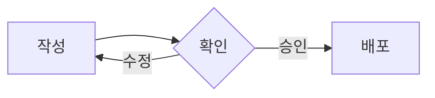
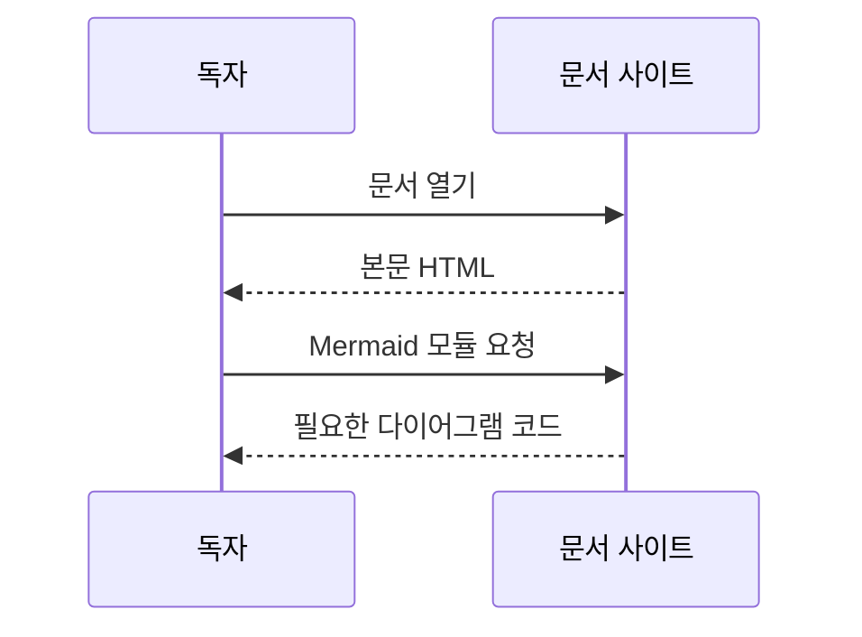
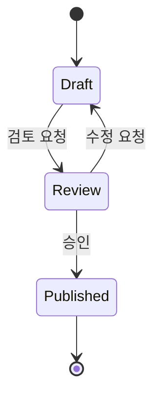
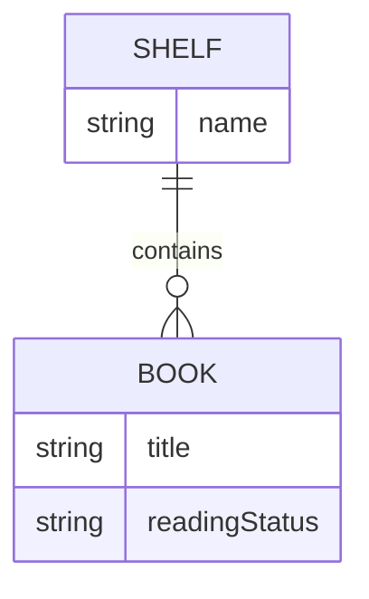
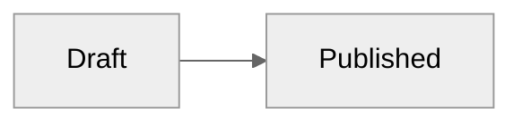

연결의 의미에 맞는 다이어그램을 고릅니다. 모든 예시는 `mermaid` 코드 펜스에 작성하며 공식 Mermaid 12로 표시합니다.
별도 설치 없이 Markdown 안에 다이어그램을 작성할 수 있습니다. 다이어그램은 JavaScript를 사용하는 브라우저에서 표시됩니다.

## Choose a diagram

| 설명할 내용 | Mermaid 문법 | 선택 기준 |
| --- | --- | --- |
| 절차와 조건 분기 | `flowchart` | 다음 단계와 갈림길 |
| 참여자 사이 요청과 응답 | `sequenceDiagram` | 누가 누구에게 어떤 순서로 요청하는지 |
| 상태 전이 | `stateDiagram-v2` | 가능한 상태와 상태를 바꾸는 사건 |
| 데이터 관계 | `erDiagram` | 엔터티와 관계의 수 |
| 폴더와 파일 계층 | `treeView-beta` | 부모와 자식, 같은 단계의 항목 |

Flowchart만으로 모든 관계를 표현할 필요는 없습니다. 짧은 절차는 목록, 항목 비교는 표가 더 간단할 수 있습니다.
Mermaid에 기본 포함된 다른 유형도 같은 펜스에서 사용할 수 있습니다. 별도 등록이 필요한 외부 다이어그램과 아이콘 팩은 자동 포함하지 않습니다.

## Flowchart

````markdown

````


## Sequence

````markdown

````


## State

````markdown

````


## Entity relationship

````markdown

````


## Tree View

들여쓰기로 계층을 표현합니다. 폴더 이름 끝에는 `/`를 붙입니다.
기존 `├──`, `└──`, `│` 형식도 `treeView-beta` 아래에서 사용할 수 있습니다. [Images](images.md#relative-paths)에 실제 예시가 있습니다.
Tree View는 Mermaid의 beta 문법이므로 버전 갱신 때 예제를 함께 확인합니다.

````markdown

````


## Themes and rendering

다이어그램은 사이트의 밝은 테마와 어두운 테마를 따릅니다. 개별 다이어그램의 테마를 지정하려면 코드 블록 안에 다음 설정을 작성합니다.

````markdown

````

접힌 Details 안의 다이어그램은 펼친 뒤 렌더링합니다. 같은 페이지에서 여러 유형을 함께 사용할 수 있으며 한 다이어그램의 오류가 나머지를 막지 않습니다.
문법 오류는 브라우저에서 안내와 원문을 표시합니다. 정적 빌드 성공만으로 다이어그램 문법이 올바른지 확인할 수는 없으므로 preview에서도 확인합니다.
원문은 다이어그램 하나당 50,000자까지 렌더링합니다. 제한을 넘겨도 원문과 오류 안내를 유지합니다.
다이어그램을 불러오지 못하거나 JavaScript가 꺼진 경우에는 원문을 표시합니다. 재접속이나 문법 수정 후 페이지를 새로고침하면 다시 렌더링합니다.

그림의 핵심과 독자가 판단할 내용은 본문에도 적습니다. 스크린 리더 설명이 필요하면 Mermaid의 `accTitle`과 `accDescr`를 지원하는 유형에서 함께 작성합니다.
공식 툴팁은 지원하지만 `strict` 보안 모드를 유지하므로 임의 JavaScript 콜백과 클릭 동작은 활성화하지 않습니다.

자세한 문법은 [Mermaid 유형별 문법](https://mermaid.ai/open-source/intro/), [공식 테마](https://mermaid.ai/open-source/config/theming.html), [Tree View](https://mermaid.ai/open-source/syntax/treeView.html) 문서를 참고합니다.
