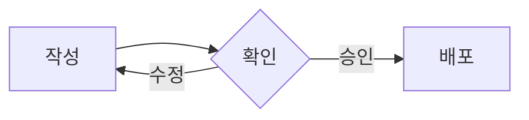
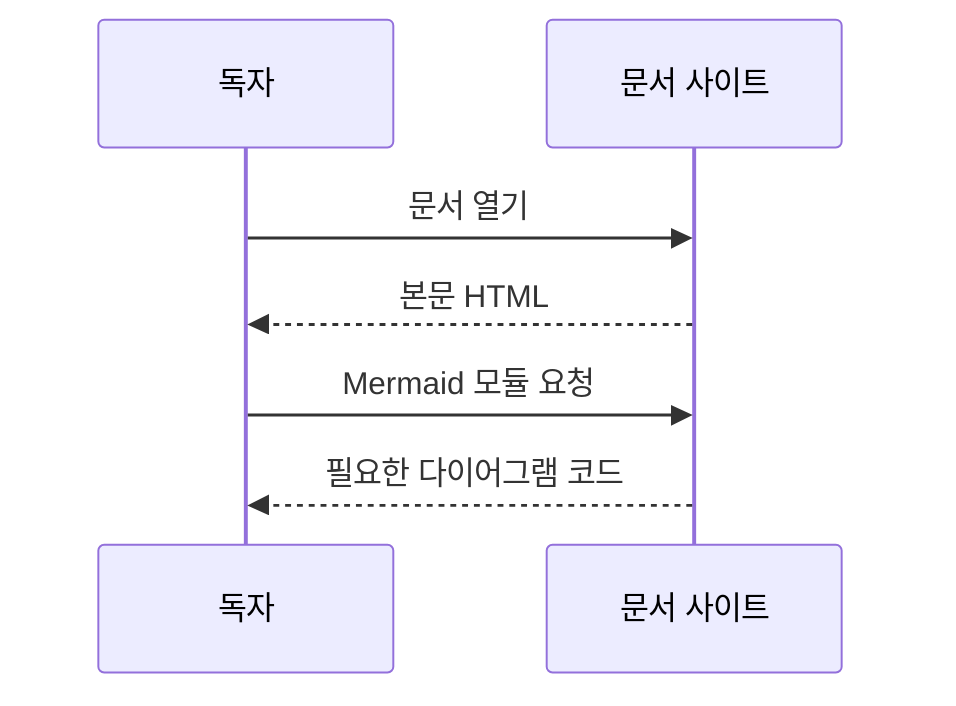
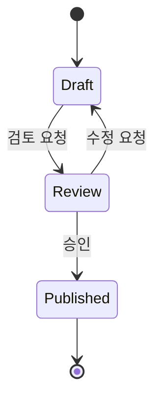
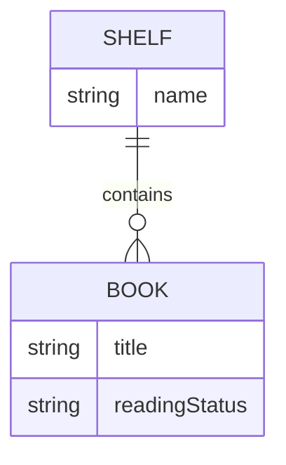
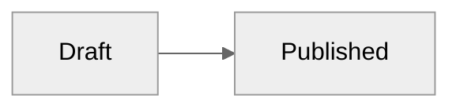

연결의 의미에 맞는 다이어그램을 고릅니다. 모든 예시는 `mermaid` 코드 펜스에 작성하며 공식 Mermaid 12로 표시합니다.
다이어그램이 있는 페이지에서만 사이트에 포함한 모듈과 필요한 유형의 청크를 불러옵니다. 외부 CDN이나 독자의 별도 설치는 필요하지 않습니다.

## Choose a diagram

| 설명할 내용 | Mermaid 문법 | 선택 기준 |
| --- | --- | --- |
| 절차·조건 분기 | `flowchart` | 다음 단계와 갈림길 |
| 참여자 사이 요청·응답 | `sequenceDiagram` | 누가 누구에게 어떤 순서로 요청하는지 |
| 상태 전이 | `stateDiagram-v2` | 가능한 상태와 상태를 바꾸는 사건 |
| 데이터 관계 | `erDiagram` | 엔터티와 관계의 수 |
| 폴더·파일 계층 | `treeView-beta` | 부모·자식과 같은 단계의 항목 |

Flowchart만으로 모든 관계를 표현할 필요는 없습니다. 짧은 절차는 목록, 항목 비교는 표가 더 간단할 수 있습니다.
Mermaid에 기본 포함된 다른 유형도 같은 펜스에서 사용할 수 있습니다. 별도 등록이 필요한 외부 다이어그램과 아이콘 팩은 자동 포함하지 않습니다.

## Flowchart

````markdown

````


## Sequence

````markdown

````


## State

````markdown

````


## Entity relationship

````markdown

````


## Tree View

들여쓰기로 계층을 표현합니다. 폴더 이름 끝에는 `/`를 붙입니다.
기존 `├──`, `└──`, `│` 형식도 `treeView-beta` 아래에서 사용할 수 있습니다. 실제 예시는 [Images](images.md#relative-paths).
Tree View는 Mermaid의 beta 문법이므로 버전 갱신 때 예제를 함께 확인합니다.

````markdown

````


## Themes and rendering

밝은 화면은 Mermaid의 유형별 기본 테마를 사용합니다. Flowchart·sequence·state·ER 등은 `redux-color`와 `neo`가 기본입니다.
어두운 화면은 공식 `redux-dark-color` 테마를 사용하며 시스템 설정 변경 때 다시 그립니다. 문서 본문의 글꼴·색 규칙은 SVG 내부에 적용하지 않습니다.
Tree View의 기본 검정 글자와 선은 어두운 화면에서 문서 글색을 따르도록 보정합니다.
작성자가 다이어그램 frontmatter에서 지정한 테마가 우선합니다.

````markdown

````

접힌 Details 안의 다이어그램은 펼친 뒤 렌더링합니다. 같은 페이지에서 여러 유형을 함께 사용할 수 있으며 한 다이어그램의 오류가 나머지를 막지 않습니다.
문법 오류는 브라우저에서 안내와 원문을 표시합니다. Node.js 빌드를 중단하지 않습니다.
원문은 다이어그램 하나당 50,000자까지 렌더링합니다. 제한을 넘겨도 원문과 오류 안내를 유지합니다.
모듈 수신 실패나 JavaScript 비활성 환경에서도 원문은 유지합니다. 재접속이나 문법 수정 후 페이지를 새로고침하면 다시 렌더링합니다.

그림의 핵심과 독자가 판단할 내용은 본문에도 적습니다. 스크린 리더 설명이 필요하면 Mermaid의 `accTitle`·`accDescr`를 지원하는 유형에서 함께 작성합니다.
공식 툴팁은 지원하지만 `strict` 보안 모드를 유지하므로 임의 JavaScript 콜백과 클릭 동작은 활성화하지 않습니다.

참조: [Mermaid 유형별 문법](https://mermaid.ai/open-source/intro/), [공식 테마](https://mermaid.ai/open-source/config/theming.html), [Tree View](https://mermaid.ai/open-source/syntax/treeView.html).
