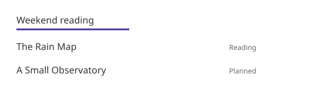

You reference local images, videos, audio and attachments relative to the location of the document file. The same file is served at the same content-hashed URL in dev and in the static build.
Write the description and source of an image in ordinary Markdown. There is no separate Figure directive yet.

## Relative paths


In `content/public/guide/screen.md`, write the following.

```markdown


A fictional figure with bookshelf names and a selection marker.
[View the figure larger](../../asset/sample.svg)
```

The figure below is a fictional example asset from this repository.



A fictional figure that distinguishes the selected bookshelf by its name and a highlight line.
[View the figure larger](../asset/sample.svg)

The same relative path rules apply to reference-style images and to `` in raw HTML. Each candidate in `srcset` and the `poster` of `<video>` follow the same rules. The same goes for the `src` of `<video>`, `<audio>`, `<source>`, `<track>` and `<embed>` and the `data` of `<object>`.
The README in content and the child documents are handled the same way. A referenced file must be inside the content root. Keep shared assets in `content/asset` and private assets in `content/private/asset`. Referencing private assets in a public build causes an error.

## Narrow screens

An image alone in its own paragraph is laid out as a figure, with the same space above and below as tables and code blocks.
On screens narrower than 640px, an SVG figure keeps the `width` and `height` written in the SVG file, and a figure wider than the body scrolls sideways like a wide table. Keyboard users can focus the figure and scroll it with the arrow keys. Wider screens show the figure at its own size, narrowed to the body width when it is wider.
An SVG with only a `viewBox` has no size of its own and fills the body width. Write `width` and `height` at the size its text is meant to be read.
Raster images such as PNG and JPEG always shrink to the body width, because their pixel size depends on the capture scale. An image inside a sentence, an image wrapped in a link and an image in a raw HTML paragraph with attributes are not laid out as figures.

The example figure above is 560px wide, so on a phone you scroll it sideways.

## Build and dev

Only referenced files are copied to `content/dist/_fh/media/`. Whole image folders and nearby personal files are not copied automatically.
The URL includes a fingerprint of the file content. Files with the same content and extension share the same URL. When you change a file, its URL changes too.
The query and hash suffixes of a relative URL are preserved. If a file name contains a space, you can write it as `%20` in the link.
For local PNG, JPEG, GIF, WebP and AVIF images, the original size is added as `width` and `height` so the body does not shift while the image loads. If you wrote the size on `` directly, it is left as is. Sizes are not added to SVG.

When you edit or add a supported figure or attachment in the document folder, dev processes it again and refreshes the page.
It also rechecks a figure that did not exist when it was first referenced and was saved later. Changes in the output folder and the installation folder are excluded.
If you added a new image link, save the Markdown. If you save an incorrect path, dev shows an error and keeps the last good page.

## Supported files

Images support the SVG, PNG, JPG/JPEG, GIF, WebP and AVIF formats. Only these formats can be used in Markdown images, ``, `srcset` and `poster`.
Specify videos and audio in the `src` of raw HTML `<video>`, `<audio>` and `<source>` in the MP4, WebM and MP3 formats.
Specify subtitles in the `src` of `<track>` in the WebVTT (`.vtt`) format. The `src` of `<embed>` and the `data` of `<object>` can use PDF and the image formats above.
Attachment links can use the formats above plus PDF, CSV, TXT and ZIP. Executable files, project source and configuration files are not deployed automatically.
If you link a local file in a format that is not deployed, the build does not stop and the terminal shows a warning with the file and line number. An `<iframe>` that points to a local file cannot be deployed either, so it shows the same warning.

A missing local image, video, audio, subtitle, embedded file or attachment is a build error. So is a path outside the root or a symlink that points outside.
The build also fails if you put an unsupported format where an image, video, audio, subtitle or embedded file is expected. Link to a non-image file such as a PDF as an attachment link.
External URLs, data URLs and site-root-relative absolute URLs are neither rewritten nor downloaded. You provide the files for absolute URLs separately.
CSS and JS inside Markdown, external files inside an SVG and CSS `url()` dependencies are not collected recursively. Use an SVG that can be displayed on its own.
