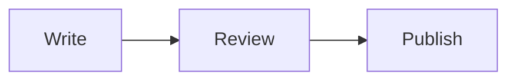

Write each document as one Markdown file. Put the document information at the top of the file and the body below it.

## Your first document

Create `content/public/guide.md` and write the following.

```markdown
---
name: Guide
label: Getting started with the project
group: Guide
order: 10
---

A guide for people who use the project for the first time.

## Installation

List what you need to prepare before installing.

## Usage

### First step

Describe the first task.
```

When you run `dev`, the document appears in the Guide group of the sidebar. The document address is `/guide/`.
The `##` and `###` headings appear in the page outline. The document title is displayed from `name`, so you do not need to repeat the same `#` heading in the body.

public holds documents to deploy, and private holds documents to read only locally. Other Markdown files outside these two folders are not added to the document list automatically.

## Home page

`content/README.md` is the site home page (`/`). Write the title and introduction without frontmatter.

```markdown
# Project notes

An introduction to the project and a guide to its documents.

[Get started](public/guide.md)
```

Selecting the site name goes to the home page. If there is no README, a guide to writing the home page appears.
READMEs inside public and private are ordinary documents, so write frontmatter in them like in any other document.

## Frontmatter

| Field | Use | Required |
| --- | --- | --- |
| `name` | Title shown in the body and the sidebar | Required, a non-empty string |
| `label` | Document description shown in the sidebar tooltip, search results and link previews | Required |
| `group` | Sidebar group name or array of names | Required, a non-empty value |
| `order` | Reading order within the same group | Optional, an integer of 0 or more |
| `parent` | ID of the parent document in the same group | Optional |

A new document does not need `type`. Existing `document` and `blueprint` values are still read and shown as the same kind of document.
You can use any language for titles and groups.

### Navigation groups

Documents with the same `group` are shown together. A smaller `order` is shown first. Documents without `order` are shown after the ordered ones, sorted by title.

```yaml
group: [Projects, Research]
order: 10
```

The document above appears in the Research group inside Projects. The display order of groups is set with `navigation` in the site configuration.
Changing a group name or order does not change the document URL. To place child documents under a document, see the `parent` example in [Navigation](navigation.md).

### File names

The ID of a public document is the lowercase path relative to the public folder, without the extension. `public/guide/setup.md` is shown as `/guide/setup/`.
Private documents get a `/private/` prefix. `.mdx` is also read as Markdown, and JSX is not executed.

Two files that resolve to the same ID cannot be used together. For example, `Guide.md` and `guide.mdx` conflict.
Do not use `#`, `?`, `%`, `*`, `:`, `\` or control characters in file names. The path segments `.`, `..` and `index.html` are also not allowed.
The first path segments `_fh` and `favicon.svg` are for default assets, `private` is for private documents, and a language code from `locales` is for its translations. If you set `url`, `robots.txt` and `sitemap.xml` are reserved as well.

## Sections and parts

`##` is a major section, and `###` is a subheading under it. To group several related sections, put `::part[Title]` before them.

```markdown
::part[Getting started]

## Installation

Installation instructions.

## Usage

### First step

Running instructions.
```

A part divider marks a group of sections in the body and the outline. Headings are not numbered automatically. If you need numbers, write them in the heading yourself.
A `::part` with no title or an empty title is a build error. The title is plain text without formatting and cannot take attributes.
After a `::part`, there must be at least one Markdown `##` section before the next `::part` or the end of the document.

### Links

To link to other documents and the home page from `content/public/guide.md`, write the following.

```markdown
[Configuration](settings.md)
[Navigation configuration](settings.md#navigation)
[Home](../README.md)
```

Relative `.md` links are converted to site URLs, and the query and hash are kept. `settings.md#navigation` above links to `/settings/#navigation`.
A link to a README of an ordinary document goes to that document, and a link to `content/README.md` goes to the home page.
A link to a document that does not exist does not stop the build. The terminal shows a warning with the file and line number. The same conversion and warning apply to `<a href="...">` in raw HTML.
A link to a local file of a type that is not deployed shows the same warning. For the types that are deployed, see [Images](images.md#supported-files).

Heading anchors are generated automatically from the headings. If the same heading repeats, `-1` and `-2` are appended.
Navigating to a heading inside Details expands the collapsed content.
In public documents and the home page, do not link to private files or `/private/` paths.

## Flowcharts

Set the language of the code block to `mermaid`.

````markdown

````


For examples of diagrams for sequences, states, relationships and folder structures, see [Diagrams](diagrams.md).

## Code notation

Write a language name on a code block to highlight its syntax. `line-numbers` shows line numbers, and `[file name]` shows a file title.

````markdown
```ts line-numbers [example.ts]
const title = "Project notes"; // [!code highlight]
const count = 3;
```
````

```ts line-numbers [example.ts]
const title = "Project notes"; // [!code highlight]
const count = 3;
```

| Notation | Result |
| --- | --- |
| `// [!code highlight]` or code block meta `{2,4-6}` | Highlights the lines |
| `// [!code error]` and `// [!code warning]` | Marks error and warning lines |
| `// [!code ++]` and `// [!code --]` | Marks added and removed lines |
| `// [!code word:title]` | Highlights a word in that line |
| Meta `line-numbers` | Line numbers |
| Meta `bad` and `good` | Distinguishes the backgrounds of wrong and correct examples |
| Meta `[file name]` | File name above the code |

Notation comments are hidden in the output. Use the comment syntax of each language.

## Code snippets

If you keep example code in separate files, you can import it with `<<<`.

```markdown
<<< ./example/response.ts
<<< ./example/response.ts#contract line-numbers [response.ts]
```

The path is relative to the current Markdown file. The file must be inside the content root. Public documents cannot import private files.
Adding `#contract` shows only the part of the file between `// #region contract` and `// #endregion contract`. An unnamed `// #endregion` closes the innermost open region.
Write a region marker as `#region` after a comment symbol, as in `// #region contract`, `/* #region contract */` or `<!-- #region contract -->`. In files with the following extensions, you can also use that language's notation.

| Extension | Additional marker |
| --- | --- |
| `.py`, `.yml`, `.yaml`, `.sh`, `.bash`, `.zsh`, `.coffee`, `.cs`, `.ps1` | `# region contract`, `# #region contract` |
| `.c`, `.h`, `.cc`, `.cpp`, `.cxx`, `.hh`, `.hpp`, `.hxx` | `#pragma region contract` |

In files with other extensions, lines written with a space such as `# region` or `## region` remain as body text, not markers.

To write the end marker, replace `region` with `endregion`.
Region marker lines and the common indentation are removed. Specifying a region that does not exist, or a region that is not closed by the end of the file, is a build error.
The language is determined by the file extension. After the path you can use the same meta as a code block. In dev, changes to imported files are also reflected.

## Content features

You can use tables, lists, task lists, links, inline code and ordinary Markdown formatting.
For image and attachment paths, see [Images](images.md), and for emphasis of status phrases in the body, see [Status badges](settings.md#status-badges).
Hex color values of 3, 4, 6 or 8 digits written as inline code, such as `#e80030`, are shown with a color swatch.
You can also use raw HTML, but it does not automatically fetch CSS and JavaScript from other sites.
Heading anchors are also created for `<h2>` and `<h3>` in raw HTML, and they appear in the outline. Raw HTML tables are also put in the same horizontal scroll box as Markdown tables.

## Block components

Use Note to keep supplementary explanations visible, and Details to let readers expand them when needed.

```markdown
:::note[Before you start]
Node.js 22.12.0 or later is required.
:::

:::details[More information]
Use one configuration file per project.
:::
```

A title and a body are required. Adding `{open}` to Details makes it open from the start.
For examples, nesting rules and error rules, see [Parts](parts.md).
