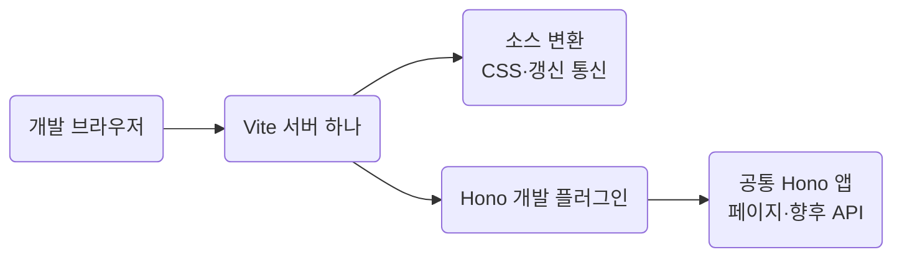

라이브러리 내부 구현을 수정하는 사람을 위한 참고 문서.
Hono 라우팅과 정적 출력, Hono JSX 서버 렌더링, unified Markdown processor.
브라우저 탐색·앵커·커서는 `hono/jsx/dom` 위젯이 소유하고, 공통 문서 앱이 파일을 읽어 본문 HTML을 준비합니다.

## Overview


| Entry       | Responsibility                               | Runtime       |
| ----------- | -------------------------------------------- | ------------- |
| `src/entry/cli/cli.ts` | 인자 · 설정 · 정적 출력 · 실행기 선택 | Node.js |
| `src/app/load-site.ts` | 문서·폰트·자원 준비 · 공통 Hono 앱 조립 | Node.js |
| `src/entry/dev/to-dev-config.ts` | Vite 서버 · Hono 연결 · 문서 갱신 | Node.js · dev |
| `src/entry/preview/to-preview-config.ts` | Vite 정적 미리보기 · 출력 경로·404·폰트 캐시 | Node.js · preview |
| `src/app/_function/to-page-app.tsx` | 첫 화면과 문서 라우트 · Hono JSX → HTML | Node.js |
| `src/app/_function/to-http-app.ts` | 등록 자원 · 페이지와 크롤러 앱 위임 | Node.js · dev |
| `src/app/_function/to-crawling-app.ts` | 공개 URL을 설정한 사이트의 robots.txt · 사이트맵 응답 | Node.js |
| `src/entry/browser/browser.tsx` | 입력 검증 · 저장소 생성 · 브라우저 셸 마운트 | Browser · 동기 |

::part[Engine]

## Runtime direction

Vite 개발·빌드와 이후 서버 기능의 설계 기준. API·인증·DB는 별도 로드맵입니다.

| 구성 | 책임 |
| --- | --- |
| Vite | 개발 HTTP 서버, 파일 감시, 브라우저 갱신 통신, 서버·브라우저 코드 빌드, 정적 미리보기 |
| Hono | 페이지와 API 라우팅, 요청별 미들웨어, HTML·JSON 응답 |
| 문서 처리 | 설정 검증, Markdown 변환, 문서·자원 목록 생성, 정적 출력 |
| 향후 기능 모듈 | 검색, 인증·권한, 사용자 데이터와 외부 서비스 연결 |

개발에서는 Vite 서버 하나가 요청을 받고 `@hono/vite-dev-server`가 페이지 요청을 Hono 앱에 연결합니다. JS·CSS 변환과 갱신 통신도 같은 서버를 사용합니다. 플러그인이 별도의 Hono HTTP 포트를 여는 구조는 아닙니다.



운영 방식은 기능에 따라 선택합니다. 현재 공개 문서는 빌드한 HTML·JS·CSS만 배포합니다. 향후 요청별 인증이나 데이터 조회를 제공하면 Node 서버 또는 선택한 서버리스 환경에서 Hono 앱을 실행하고, Vite로 빌드한 자원을 함께 제공합니다. Vite 개발 서버와 `vite preview`는 운영 서버로 사용하지 않습니다.

공통 Hono 앱은 CLI 인자와 Vite 서버를 직접 참조하지 않습니다. 개발 연결과 운영 실행 어댑터가 같은 앱을 사용하도록 구성합니다. Markdown 파일 읽기는 빌드·준비 단계에 두며 페이지 요청마다 반복하지 않습니다. 정적 생성 대상은 공개 페이지와 크롤러 파일이고, 향후 API·인증 라우트는 정적 생성 대상에서 제외합니다.

현재 문서 준비와 등록 자원 응답은 Node 파일 시스템을 사용합니다. 다른 서버리스 런타임을 지원할 때는 준비된 문서 자료와 자원 제공 방식을 해당 플랫폼에 맞게 연결하고 별도로 검증합니다.

참조: [Hono Vite 개발 플러그인](https://github.com/honojs/vite-plugins/tree/main/packages/dev-server), [Hono Node 서버](https://hono.dev/docs/getting-started/nodejs), [Vite 배포](https://vite.dev/guide/static-deploy).

### Development, preview and production

`dev`는 원본을 수정하면서 확인하는 실행기이고, `preview`는 이미 빌드한 사이트를 로컬에서 확인하는 실행기입니다. 운영 환경에는 정적 결과물 또는 실제 요청을 처리하는 Hono 앱을 배포합니다.

| 실행 | 입력과 동작 | 용도 |
| --- | --- | --- |
| `dev` | 원본 문서·소스, Vite 파일 감시·변환·갱신, Hono HTML 응답 | 작성·개발 중 확인 |
| `build` | 문서 처리와 정적 생성, `<문서 폴더>/dist` 출력 | 배포 파일 생성 |
| `preview` | `<문서 폴더>/dist`의 HTML·CSS·JS 제공, 원본 감시·HMR 미사용 | 빌드 결과 확인 |
| 정적 운영 | 호스팅 서비스가 빌드 파일 제공 | 현재 공개 문서 배포 |
| 향후 동적 운영 | 배포 환경이 Hono 앱 실행, 인증·DB 조회·API 응답 | 서버 기능 제공 |

preview는 Vite의 `preview()`로 사이트 출력 폴더만 제공합니다. 패키지 코드가 들어 있는 저장소 루트 `dist`와 사이트 출력 폴더를 혼동하지 않도록 출력 경로를 명시합니다. 소비 프로젝트의 Vite 설정·환경 파일은 자동으로 실행하지 않습니다. `appType: "mpa"`로 없는 문서에 홈 화면 대신 404를 반환하며, 끝 슬래시 없는 문서 주소는 폴더의 `index.html`로 연결합니다. 폰트는 기존 장기 캐시 헤더를 유지하고 없는 파일에는 적용하지 않습니다. 빌드 결과가 없으면 서버 시작 전에 실패합니다.

dev와 preview는 `localhost`의 사이트 설정 포트를 사용하며, 포트 충돌 시 다른 번호로 자동 변경하지 않습니다. preview에는 Hono 앱·개발 클라이언트·파일 감시를 연결하지 않습니다. CLI와 브라우저 fixture는 같은 `toPreviewConfig`를 사용합니다. `@hono/node-server` 직접 의존성은 제거했지만 `@hono/vite-dev-server`의 전이 의존성은 남습니다.

API를 추가해도 개발 명령 하나와 같은 HTTP 포트를 유지하는 방향입니다. Vite가 API를 생성하거나 DB를 실행하는 것은 아닙니다. Hono 라우트와 인증·저장소 코드를 구현하고 개발 플러그인에 연결해야 합니다. 현재는 문서 앱만 연결되어 있으며 API·DB 확장 설정은 제공하지 않습니다.

```text
향후 dev
  Vite 개발 서버 하나
    ├─ JS·CSS 변환, 파일 감시, 브라우저 갱신
    └─ Hono 앱
         ├─ 문서 HTML 응답
         └─ API·로그인 처리 → 개발용 DB 또는 외부 서비스

현재 정적 배포
  문서 build → 사이트 dist → 정적 호스팅 → 사용자

향후 동적 배포
  앱·자원 빌드 → 배포 환경 → Hono 앱 → 사용자 소유 DB
```

원격 개발용 DB는 연결 설정이 필요하고, 로컬 DB는 별도 프로세스나 컨테이너로 실행해야 합니다. 실행 명령을 묶는 것은 가능하지만 Vite의 자동 기능은 아닙니다. Cloudflare D1 같은 플랫폼 전용 기능을 사용하면 해당 개발 플러그인·실행 환경도 연결해야 합니다. API 변경 반영, 연결 정리, 비밀값 비공개를 포함해 후속 단계에서 검증합니다.

| 향후 배포 대상 | Hono 실행 방식 |
| --- | --- |
| Cloudflare Workers | Cloudflare 런타임이 Hono의 `fetch` 호출 |
| AWS Lambda | Lambda 핸들러와 어댑터가 요청을 Hono에 전달 |
| Node.js 서버·컨테이너 | 운영 진입점에서 `@hono/node-server` 등으로 HTTP 서버 실행 |

`@hono/node-server`는 preview 전용 도구가 아닙니다. Node.js 운영 서버에서도 사용할 수 있지만 Workers·Lambda에는 각 환경에 맞는 진입점이 필요합니다. 정적 파일과 API는 같은 도메인·배포 프로젝트로 구성할 수 있으며 반드시 서버 두 대를 운영할 필요는 없습니다. `vite preview`는 운영 앱 실행이나 플랫폼별 동작 검증을 대신하지 않습니다.

참조: [Hono Cloudflare Workers](https://hono.dev/docs/getting-started/cloudflare-workers), [Hono AWS Lambda](https://hono.dev/docs/getting-started/aws-lambda), [Hono Cloudflare + Vite](https://hono.dev/docs/getting-started/cloudflare-workers-vite).

### Search, identity and storage

검색·로그인·DB 연결은 아직 제공하지 않습니다. Vite 전환에는 다음 확장 원칙만 포함합니다.

| 요구사항 | 저장소와 실행 방식 |
| --- | --- |
| 공개 문서와 문서 검색 | Markdown과 빌드 시 검색 인덱스, 브라우저 검색. 별도 DB 불필요 |
| 로그인 | 사용자가 선택한 인증 서비스 또는 지원하는 자체 호스팅 방식. 계정·세션 저장 위치는 인증 방식에 따라 결정 |
| 사용자별 데이터·비공개 검색 | 서버의 권한 검사와 사용자 소유 DB 또는 검색 서비스 연결 |
| 기존 사내 API 연결 | 사용자가 운영하는 API를 서버에서 호출하는 어댑터 검토 |

for-humanity 패키지는 사용자 DB를 대신 호스팅하지 않습니다. 사용자가 저장소·인증 서비스·배포 환경과 자격 증명을 관리합니다. 패키지는 지원하는 연결 설정·어댑터 타입, 필요한 데이터 모델·마이그레이션, HTTP API의 요청·응답·오류 계약을 기능과 함께 제공합니다. 지원 DB와 인증 제공자는 실제 요구사항을 확인한 뒤 결정하며, 임의의 기존 DB 스키마와 자동 호환되는 계약은 제공하지 않습니다.

HTTP API 명세는 브라우저나 외부 앱이 Hono 기능을 호출하는 계약입니다. DB 어댑터는 Hono 기능이 저장소를 읽고 쓰는 서버 내부 계약입니다. DB 연결 문자열만 공개하거나 브라우저가 DB에 직접 연결하는 방식으로 두 계약을 합치지 않습니다. 비밀값은 서버 환경에서만 읽고 클라이언트 번들·HTML·공개 설정 출력에 포함하지 않습니다.

비공개 문서는 서버에서 접근 권한을 확인해야 합니다. 비공개 HTML·첨부·검색 인덱스를 공개 정적 출력에 넣지 않습니다. 로그인 UI만 추가하고 모든 문서를 정적 호스팅하는 구성은 비공개 문서 제공 방식으로 사용하지 않습니다.

현재 `/api/`는 API 안내 문서의 URL입니다. 향후 HTTP API의 경로는 문서 URL과의 충돌·호환성을 검토한 뒤 확정합니다. 동적 배포 명령과 운영 플랫폼 어댑터도 별도 기능으로 검증하며 이번 전환에서 지원한다고 표시하지 않습니다.

## Routing and rendering

### CLI ownership

Citty가 `dev`·`build`·`preview` 선택, 위치 인자, 도움말과 버전 표시를 담당합니다. 명령 생략 시 `dev`, 문서 폴더 생략 시 현재 폴더를 사용합니다. 사이트 실행 코드는 명령을 실행할 때만 가져오므로 도움말 조회가 사용자 설정이나 문서 처리를 실행하지 않습니다.

Consola는 빌드 결과·문서 경고·사이트 실행 오류의 공통 출력입니다. 전역 console을 교체하지 않으며 Vite와 브라우저의 진단 출력은 각 실행기가 소유합니다. `init`의 입력 프롬프트는 후속 기능이고 현재 파일 생성 명령은 제공하지 않습니다.

참조: [Citty](https://github.com/unjs/citty), [Consola](https://github.com/unjs/consola).

### Page routes

페이지 앱의 라우트: `/`, `/:slug{.+}/`. 문서 id에는 하위 폴더 포함.
`/`는 문서 폴더의 `README.md`. 일반 문서 목록과 별도로 읽고, 개발 중 함께 갱신.

공개 `url`이 설정됐으면 공통 앱의 `toCrawlingApp`에서 `/robots.txt`·`/sitemap.xml` 응답을 만듭니다. 크롤러 앱은 페이지 앱과 별도로 유지합니다. dev 앱은 두 파일 요청만 크롤러 앱에 위임하고, build는 각 앱을 `toSSG`로 출력합니다. 사이트맵은 같은 문서 store의 URL만 읽습니다. URL 미지정 프로젝트에는 크롤러 앱과 생성 파일이 없습니다.

- Hono JSX: `c.html`에 컴포넌트를 전달해 HTML 문서 생성
- build: Hono `ssgParams`와 `toSSG`로 같은 라우트 출력
- dev: Vite의 `@hono/vite-dev-server`가 공통 Hono 앱 호출
- preview: Vite `preview()`로 빌드 결과 제공

페이지 앱과 HTTP 앱의 분리는 SSG 대상과 파일 응답의 경계.
Hono의 고정 파일·wildcard 경로를 중첩 문서의 정규식 매개변수와 합치면 기본 라우터가 바뀌면서 문서 요청이 누락될 수 있으므로, 페이지 라우팅과 파일 응답도 이 경계에서 격리합니다.

### Document head

`WgShell`이 렌더마다 `unhead/server` 인스턴스를 생성해 제목·설명·charset·viewport·favicon·글꼴·CSS 태그를 조립합니다. Unhead가 중복 태그 제거와 직렬화를 담당하고 Hono는 `<html lang="ko">`와 페이지 본문을 렌더링합니다. 공용 head 인스턴스를 저장하지 않으므로 사이트나 요청 사이에 메타데이터가 섞이지 않습니다.

CSS와 글꼴 선언은 최초 HTML의 `<head>`에 포함합니다. JavaScript가 꺼져 있어도 스타일과 메타데이터가 적용되며 CSS의 상대 순서를 유지합니다. Unhead는 서버 전용으로 사용하고 브라우저 head 동기화 코드나 React 어댑터를 추가하지 않습니다. 현재 문서 이동은 전체 페이지 요청입니다.

제목은 Unhead가 텍스트로 escape합니다. 설명 속성은 현재 Unhead 직렬화가 따옴표만 처리하므로 `escapeHtml`로 HTML 엔티티까지 보존합니다. `&copy;` 같은 입력과 태그 모양의 문자열이 브라우저에서도 원문으로 남는지 검증합니다. Hono의 `raw`에는 Unhead가 직렬화한 태그만 전달합니다.

현재 공개 설정은 기존 `title`·`description`을 유지합니다. 페이지별 canonical·Open Graph·구조화 데이터 설정은 후속 요구사항에 맞춰 추가합니다.

참조: [Unhead](https://github.com/unjs/unhead).

### Document processing lifetime

`src/app/_function`이 파일 읽기·frontmatter 검증·Markdown 처리·서버 구성을 소유합니다. `create-processor`의 전용 플러그인은 그 함수 폴더의 `_` 파일에 둡니다. 본문의 표현을 만드는 플러그인은 `prose` 위젯이 계속 소유합니다.

- `build`: Markdown을 한 번 처리하고 페이지 앱의 라우트를 정적 HTML로 출력합니다.
- `dev` 첫 요청: Vite 초기화 이후 전체 문서와 README를 읽어 본문 HTML을 메모리에 준비합니다.
- 첫 정상 준비에서는 갱신 메시지를 보내지 않습니다. Vite가 연결 전 메시지를 보관하므로 최초 브라우저 연결에 불필요한 새로고침이 발생할 수 있습니다. 파일 변경 이후의 정상 준비에서만 갱신을 알립니다.
- `dev` 문서·README·자원·스니펫 변경: Vite watcher가 문서 루트를 감시합니다. 처리기를 새로 만들고 정상 문서·자원 목록을 함께 교체한 뒤 Vite WebSocket으로 전체 갱신을 알립니다. 실패하면 직전 정상 목록을 유지하고, 새 변경이 들어오거나 서버가 종료되면 이전 준비 결과를 버립니다.
- `dev` 페이지 요청: 준비한 본문을 Hono JSX 셸과 조립합니다. 요청마다 Markdown을 다시 읽거나 변환하지 않습니다.
- `preview`와 배포 사이트: 이미 생성한 HTML·CSS·자원을 제공합니다.

저장소 `pnpm dev`는 `src/app`을 Vite SSR 모듈로 읽고 브라우저 TSX를 변환합니다. 서버·브라우저 TSX는 전체 갱신, CSS는 HMR로 반영합니다. 설치 패키지의 `for-humanity dev`는 `dist/site.js`와 배포 브라우저 번들을 사용합니다. 두 실행기는 같은 개발 설정과 문서 처리 함수를 공유하며 별도 HTTP 포트를 열지 않습니다.

문서 루트의 `dist`·`node_modules`·`.git`·`.cache`는 감시에서 제외합니다. 설정 파일 변경은 재시작이 필요하며 사용자 프로젝트의 Vite 설정·환경 파일은 자동으로 읽지 않습니다. 등록 자원만 Hono가 제공하고 문서 원본·서버 설정 파일은 직접 제공하지 않습니다. 종료 시 Vite가 HTTP·WebSocket·watcher를 닫고 문서 갱신 예약을 취소합니다.

### JSX and browser runtime

페이지 JSX는 `hono/jsx`로 HTML을 만듭니다. `tsconfig.json`의 `jsxImportSource`가 `hono/jsx`이며 React 서버 렌더러와 React 의존성은 사용하지 않습니다. Markdown 본문은 unified가 HTML로 변환한 뒤 페이지의 `<article>` 안에 넣습니다.

서버에서 JSX를 출력해도 `onClick` 함수가 HTML로 전송되지는 않습니다. 브라우저 상호작용에는 별도의 클라이언트 JavaScript가 필요합니다. Hono의 `hono/jsx/dom`은 브라우저에서 컴포넌트와 Hooks를 실행할 수 있습니다.

`WgShell`은 HTML 문서·자원·본문 배치를 소유합니다. `src/component/widget/shell-controls`의 `WgShellControls`는 서버와 브라우저가 공유하는 탐색·커서 조립과 앵커 수명을 소유합니다. `browser.tsx`는 DOM과 서버 자료를 찾고 검증·스토어 생성·최초 마운트를 실행하는 진입점입니다.

서버는 `WgShellControls`로 탐색 링크를 출력합니다. 브라우저 진입점은 `hono/jsx/dom/client`의 `createRoot(root).render(...)`로 같은 영역을 브라우저 JSX로 교체합니다. 이후 드로어·현재 헤딩은 Hooks와 JSX 이벤트로 갱신합니다. 컴포넌트 해제는 같은 root의 `unmount()`가 Effect 정리를 실행합니다. 본문은 마운트 범위 밖의 서버 HTML로 유지합니다.

정적 출력과 설치 패키지는 Hono 브라우저 렌더러로 탐색·커서 영역을 첫 paint 전에 마운트합니다. 저장소 소스 개발만 Vite module 진입점을 비동기로 로드합니다. 본문은 서버가 만든 HTML을 그대로 표시하고 문서 링크는 전체 페이지를 이동합니다.

현재 Hono의 `hydrateRoot`는 내부에서 `createRoot`와 `render`를 호출합니다. React의 hydration처럼 기존 DOM을 재사용하는 의미가 아닙니다. `createRoot`는 갱신·해제할 수 있는 root 수명을 제공하며 최초 DOM 교체 방식은 같습니다. [Hono 구현](https://github.com/honojs/hono/blob/main/src/jsx/dom/client.ts)

JSX·Hooks로 동작을 소유하면서 정적 본문을 유지하는 현재 조건에서는 작은 제어 영역을 한 번 마운트하는 구성을 사용합니다. 최초 DOM 교체 비용은 남습니다. DOM 재사용을 요구한다면 실제 hydration을 제공하는 렌더러나 서버 DOM에 이벤트를 직접 연결하는 구성이 필요하며, 후자는 DOM과 상태 갱신을 함께 관리해야 합니다.

참조: [Hono JSX](https://hono.dev/docs/guides/jsx), [Hono Client Components](https://hono.dev/docs/guides/jsx-dom).

## Navigation lifecycle

문서 링크는 전체 HTML 페이지를 이동합니다.  탐색의 클라이언트 상태는 Zustand vanilla 스토어가 소유합니다.
문서 목록과 On this page는 각각 독립 스크롤 컨테이너입니다. 1360px 이상에서는 같은 폭의 양쪽 사이드바로 표시하고, 그 아래에서는 목차를 숨깁니다. 모바일 드로어에는 문서 목록만 포함합니다.

`vite.config.ts`의 browser 모드가 Vite로 `src/entry/browser/browser.tsx`를 단일 IIFE로 컴파일합니다. 문서 앱은 생성한 `dist/browser.js`를 코드 문자열로 읽고 탐색 HTML과 탐색 전용 JSON 바로 뒤, 본문 앞에 포함합니다. JSON에는 문서 이름·URL·계층·현재 목차만 담고 본문은 포함하지 않습니다. `<`와 줄 구분자는 escape하여 작성한 이름이 script 태그를 닫지 못하게 합니다. 함수의 `.toString()`이나 수동 함수 조립은 사용하지 않습니다.
이 진입점은 첫 paint 전에 저장 상태를 읽고 `hono/jsx/dom` 런타임으로 탐색 컴포넌트를 마운트합니다. 브라우저 빌드만 `jsxImportSource=hono/jsx/dom`을 사용합니다. 외부 JS 다운로드를 기다리지 않아 메뉴 버튼·스크롤 위치가 뒤늦게 바뀌지 않습니다. 저장소 소스 개발에서는 같은 `src/entry/browser/browser.tsx`를 모듈로 로드하며 JSX 런타임은 서버와 브라우저별로 구분합니다.

CSS는 두 모드 모두 HTML의 `<head>`에 `<link rel="stylesheet">`로 제공해 JavaScript 실행 전에 적용합니다. 정적 출력과 설치 패키지는 내용 지문을 붙인 CSS 번들을 사용하고, 소스 개발은 `src/entry/dev/_constant/style.ts`의 Vite glob으로 컴포넌트·페이지 CSS 목록을 수집합니다. 기존 CSS 수정은 Vite HMR로 반영하며, CSS 파일 추가·삭제는 문서 스냅샷과 HTML의 스타일 목록을 갱신합니다. CSS import만으로 초기 스타일을 주입하면 모듈 실행 전 HTML이 먼저 보이므로 stylesheet 링크를 유지해야 합니다.

Hono의 최초 레이아웃 효과는 아직 연결되지 않은 fragment에서 실행됩니다. 스크롤 측정·복원은 이 경우에만 연결 직후 microtask로 미루며 첫 paint 앞에 완료합니다. 이후 반응형 전환에서는 연결된 요소를 동기 복원합니다.

스크롤은 Zustand `persist`가 같은 탭의 `sessionStorage`에 넓은 화면·좁은 데스크톱·드로어 위치를 따로 저장합니다. 컴포넌트는 스토어 좌표를 ref에 적용하며 저장소를 직접 읽지 않습니다. 구형 배치별 저장 키와 마이그레이션은 지원하지 않습니다.
문서 링크 순서가 달라지면 이전 위치는 무효입니다. 목차 위치는 같은 페이지에서만 복원하고 다른 문서의 목차는 시작점에서 읽습니다. 저장소가 차단되거나 값이 손상돼도 메모리 상태와 기본 탐색은 유지합니다.
`ResizeObserver`와 스크롤 이벤트는 실제 위·아래 넘침이 있는 끝만 흐리게 합니다. 강제 색상과 JavaScript 미사용 환경은 네이티브 손잡이를 사용합니다.

### Shell and cursor lifecycle

`WgShellControls`가 앵커 클릭·hash 변경·Details 공개·3초 헤딩 강조·초기 글꼴 보정을 소유합니다. 초기화는 본문 앞에서 실행되므로 본문 대상 조회는 `DOMContentLoaded` 이후로 미룹니다. 새로 생성한 `AbortController`로 DOM 이벤트를 묶고, 해제 시 이벤트·강조 타이머·도착 감시를 정리합니다. 개발 갱신 통신은 Vite가 소유합니다. 글꼴 완료를 기다리는 비동기 보정도 해제된 인스턴스에서는 실행하지 않습니다.

커서 장식은 `src/component/widget/cursor-face`의 `WgCursorFace`가 DOM ref·좌표·미디어 조건·전역 이벤트·예약 frame을 소유합니다. 마지막 좌표는 같은 탭의 페이지 이동에서만 이어받으며 터치·reduced motion에서는 숨깁니다. 본문과 커서 동작을 모듈 최상위에서 바로 실행하지 않고 컴포넌트의 Effect에서 설치·정리합니다.

`.tsx`는 JSX 문법의 구분입니다. 서버의 `hono/jsx`는 HTML을 만들고 Effect 콜백은 실행하지 않습니다. Vite가 브라우저 진입점에서 가져오는 컴포넌트·Hook을 JS로 묶으며, `hono/jsx/dom` 렌더러가 브라우저에서 Effect를 실행합니다. Hono가 Hook마다 자동으로 청크를 생성하거나 전송하는 구조는 아닙니다.

### Store ownership and lifetime

`src/store/navigation`에 생성기·저장 키·상태 계약·저장 자료 검증을 모읍니다. JSX 이벤트·반응형 배치·스크롤 영역·현재 헤딩은 `src/component/widget/navigation`이 소유하며 구독을 설치한 효과에서 정리합니다.
`createNavigationStores`는 브라우저의 탐색 진입점에서 페이지마다 생성하며, 서버 요청이나 정적 빌드에서는 실행하지 않습니다. 페이지 사이의 스크롤 위치는 `persist`가 이어받고, BFCache 복귀에서는 `persist.rehydrate()`로 최신 상태를 다시 읽습니다. 저장 자료는 스토어의 Zod 스키마로 한 번 검증하고, 손상된 저장값은 전체를 제외합니다. 스크롤 상태 타입도 같은 스키마에서 추론합니다.

실제 저장 위치는 `sessionStorage`입니다. `createJSONStorage`는 Zustand 상태 객체와 저장소의 문자열 사이에서 JSON 직렬화, 역직렬화를 담당하는 어댑터입니다. `localStorage`로 바꾸는 경우에도 같은 어댑터를 사용할 수 있지만, 탐색 위치는 현재 탭에서만 유지하는 정책이므로 `sessionStorage`를 연결합니다. 저장소 조회는 어댑터에서 지연 실행하고, 저장 차단이나 용량 부족은 메모리 상태를 유지하도록 처리합니다.

vanilla 생성기는 `use-` 접두사를 붙이지 않습니다. 스크롤 스토어는 탐색 컴포넌트가 이벤트·Effect에서 직접 읽고 쓰며, 사용자 상태는 서버 요청 사이에 공유하지 않습니다.
서버의 `PageParams.store`는 읽은 문서 목록과 홈을 담는 별도 객체이며 사용자 탐색 상태를 저장하는 Zustand 스토어가 아닙니다.

참조: [Zustand vanilla store](https://zustand.docs.pmnd.rs/reference/apis/create-store), [persist](https://zustand.docs.pmnd.rs/reference/middlewares/persist).

## Markdown pipeline

| Stage  | Work                                                                 |
| ------ | -------------------------------------------------------------------- |
| Read   | 파일 탐색 · remark-frontmatter의 YAML 노드 · yaml 값 해석 · Zod 검증 |
| remark | GFM · 문장부호 · Note·Details · part · Mermaid 원문 · status badge · swatch · 링크 · 경고 |
| rehype | 코드 강조 · 문서 header · 제목 id · 가름 수집 · 표 상자           |
| Output | raw HTML 해석 · HTML 문자열                                          |

제목 원문에서 id와 TOC 텍스트를 수집하고 가름별로 묶음. 제목 번호는 자동 생성하지 않음.
중간 계약은 `file.data.fh`. 제목과 section 정보는 문서 순서 유지.

Mermaid 펜스는 이스케이프한 원문과 렌더 영역으로 변환합니다. `WgMermaid`가 본문 파싱 후 자체 호스팅 ESM을 불러와 공식 SVG를 생성합니다.
Mermaid는 별도 ESM 그래프로 번들링하며 유형별 청크는 필요할 때 수신합니다. 프로젝트에 Mermaid 펜스가 있으면 해당 그래프를 정적 출력·dev 자원 목록에 등록합니다.
SVG는 Shadow DOM 안에 삽입해 본문의 `p`·`code`·`a` 스타일과 격리합니다. 측정용 DOM은 본문 밖에서 만들고 렌더 완료·실패·컴포넌트 해제 때 제거합니다.
테마 변경과 Details 공개 요청은 직렬 처리하고 해제 뒤의 비동기 결과는 적용하지 않습니다. 브라우저 오류와 JavaScript 비활성 환경에서는 원문을 유지합니다.
공식 `bindFunctions`에는 Shadow DOM 내부의 SVG 부모를 전달합니다. 해제 시 생성 SVG와 툴팁을 제거하고 원문으로 복원합니다.
렌더 완료는 셸에 통지하며, 초기 hash와 사용자 이동 여부를 소유한 셸이 비동기 배치 변경 후 앵커 위치를 보정합니다.
frontmatter는 정규식으로 잘라내지 않고 AST 노드로 읽음. 본문 노드의 원본 줄·열은 유지.
Note·Details의 검증은 Markdown 부품 변환 전. 제목은 native label, 본문은 기존 처리 흐름.
접힌 본문의 `###`도 같은 제목 id·TOC. 부품의 작성 계약은 [Parts](parts.md).

remark는 Markdown을 AST로 다루는 플러그인 체계. 현재의 부품 변환·검증과 rehype 연결에 사용.
markdown-it도 확장 가능한 렌더러이며 VitePress에서 사용. 한쪽이 항상 더 좋은 것은 아니고, 이 프로젝트는 기존 AST 변환을 유지.
gray-matter는 frontmatter를 분리·해석하는 다른 선택지. 여기서는 `remark-frontmatter`와 기존 `yaml`을 조합.

참조: [remark](https://github.com/remarkjs/remark), [remark-frontmatter](https://github.com/remarkjs/remark-frontmatter), [gray-matter](https://github.com/jonschlinkert/gray-matter), [VitePress Markdown](https://vitepress.dev/ko/guide/markdown).

::part[Ownership]

## Code ownership

| Concern                       | Owner                        |
| ----------------------------- | ---------------------------- |
| 첫 화면 · 문서 페이지         | `src/page`                   |
| HTML 틀 · 자원 · 본문 배치    | `src/component/widget/shell` |
| 공통 제어 UI · 앵커 수명      | `src/component/widget/shell-controls` |
| 포인터 장식 · 좌표 · 입력 구독 | `src/component/widget/cursor-face` |
| 문서 트리 계산 · 탐색 · 목차 · 드로어 | `src/component/widget/navigation` |
| 탐색 저장 상태 · 검증         | `src/store/navigation`       |
| 본문 · remark·rehype 플러그인 | `src/component/widget/prose` |
| Mermaid 원문 · 공식 SVG 렌더 수명 | `src/component/widget/mermaid` |
| processor · 문서 읽기 · 공통 앱 | `src/app` |
| 개발 HTTP · 감시 · 갱신 통신 연결 | `src/entry/dev` |
| 최초 브라우저 마운트          | `src/entry/browser` |
| 상수 · 문구 · 스키마          | `src/constant` · `src/type`  |
| 색 · 폰트 · 간격              | `src/style/token.css`        |
| 폰트 변환 · 공용 순수 함수   | `src/util`                   |

문서 렌더 결과의 공통 계약(`DocContent`, `DocOutline`, `DocSection`)은 `src/type`에 둡니다. CLI와 본문·탐색 위젯이 같은 계약을 소비하며 루트 타입이 위젯 내부 타입에 의존하지 않습니다. 문서 트리 표현 계약(`DocGroup`, `DocBranch`)은 탐색 위젯의 `_type`에 둡니다.

## Package output

`build:kit`: `vite.config.ts`의 node·browser·mermaid 모드를 순서대로 실행하고 `tsc -p tsconfig.package.json`으로 공개 선언을 생성합니다. 첫 node 빌드만 `dist`를 비우며 이후 빌드는 앞 단계의 결과를 유지합니다. Vite의 Rolldown 번들러와 Oxc 변환기를 사용하고 직접 esbuild를 호출하지 않습니다.
`util/to-browser-config.ts`는 제품과 Playwright fixture가 같은 Hono DOM 빌드 설정을 사용하게 합니다. `util/to-notices-plugin.ts`는 실제 번들 모듈의 LICENSE·COPYING·NOTICE를 수집합니다. Vite 기본 license 출력에서 빠지는 추가 고지까지 유지합니다.
폰트와 favicon 원본은 패키지에 포함, 사이트 빌드 시 결과 폴더로 복사.

- `dist/cli.js`: npm bin 진입점
- `dist/site.js`: 설치 개발 서버가 읽는 공통 문서 앱
- `dist/cli.css`: 컴포넌트 CSS 묶음
- `dist/browser.js`: HTML에 포함하는 셸·탐색·커서의 Hono JSX 런타임
- `dist/mermaid/`: 필요한 페이지에서 불러오는 Mermaid 진입 모듈·지연 청크·배포 고지
- 자원 URL: `/_fh/` · favicon: `/favicon.svg`

패키지 빌드와 문서 사이트 빌드는 별도 단계. 절차는 [Maintenance](maintenance.md).
